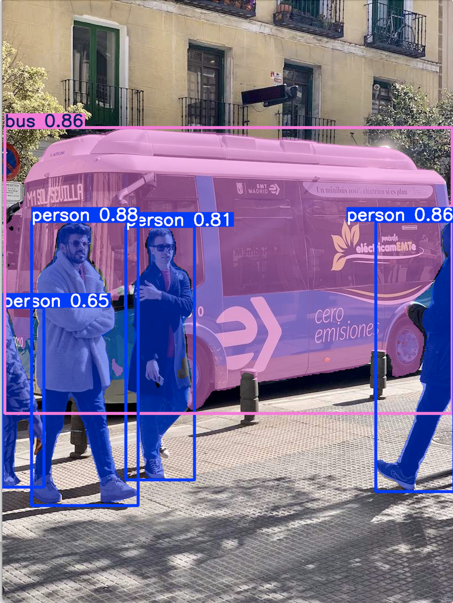
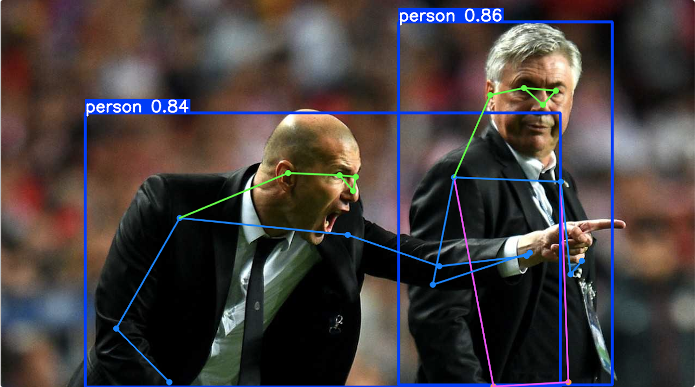
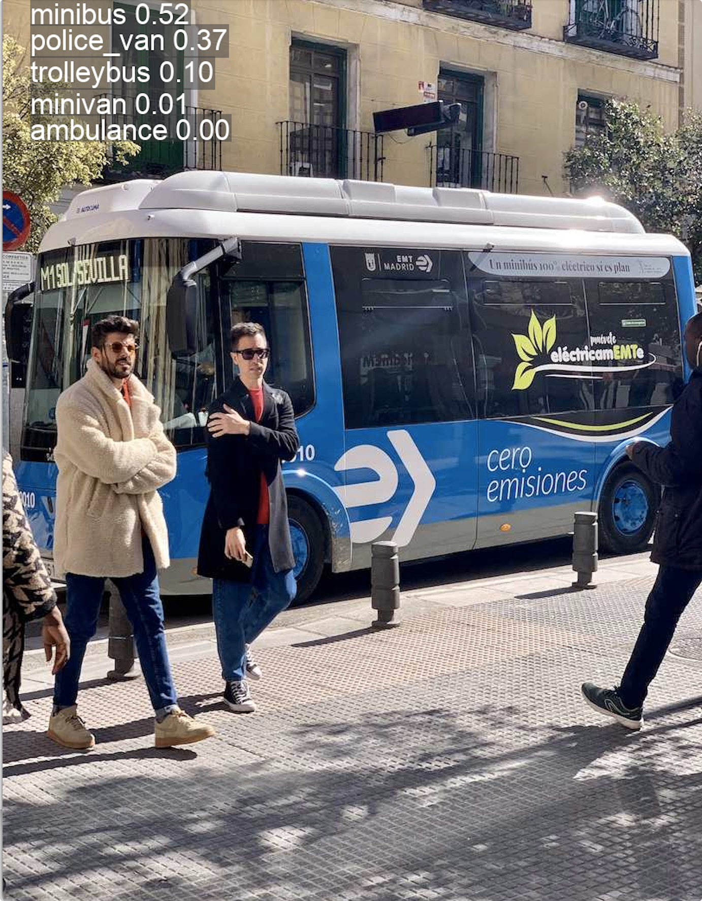
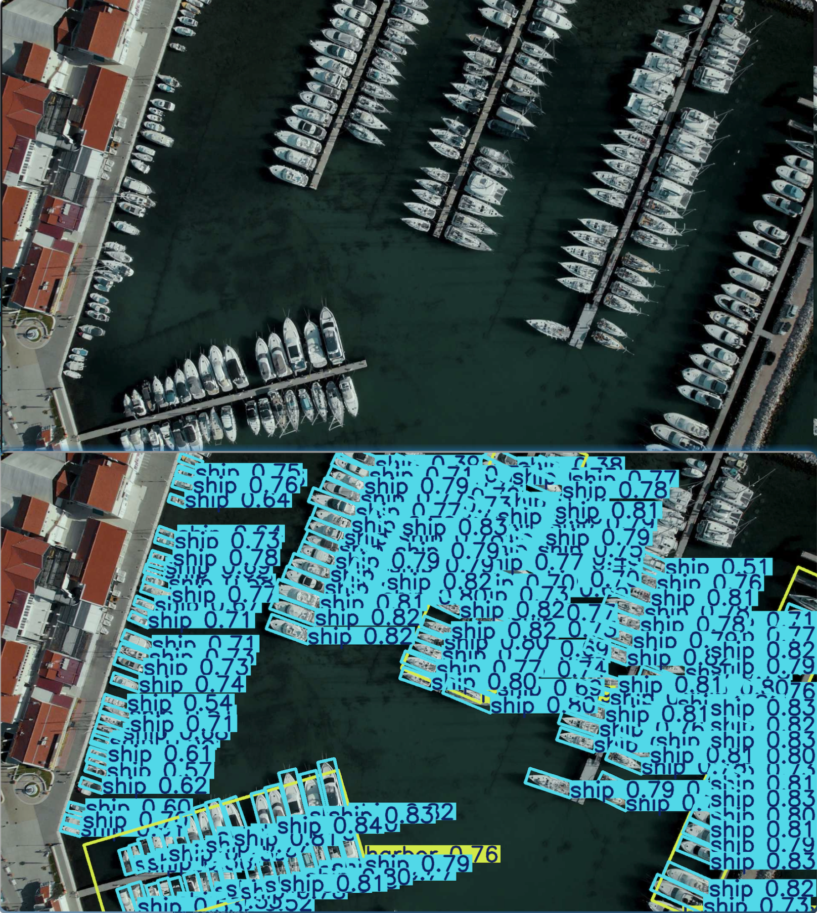

# YOLO26的多任务

YOLO26在同一套框架下原生支持了**目标检测、实例分割、姿态估计、旋转目标检测（OBB）和图像分类**五大核心视觉任务。

这彻底改变了以往不同任务需要切换不同模型的繁琐流程，实现了“一个模型，五种能力”的高效协同。

## 核心优势：五任务原生融合

YOLO26 的多任务能力并非简单拼接，其核心优势在于：

1. **统一的骨干网络**：所有任务共享同一个强大的特征提取网络，避免了为每个任务重复构建模型，大幅降低了计算开销和内存占用。
2. **专用的任务头**：在共享的骨干网络之上，为每个任务（检测、分割、姿态等）设计了轻量级且高效的专用“任务头”，确保各任务都能达到专业级精度。
3. **端到端的推理**：YOLO26 实现了无NMS（非极大值抑制）的端到端推理，进一步减少了后处理延迟，提升了整体速度。

这种设计让 YOLO26 在保持高速度的同时，具备了强大的多任务处理能力，尤其适合边缘计算等资源受限的场景。

## 五大任务总览

| 任务       | 权重后缀 | 预训练权重        | 输出核心信息                          | 典型场景                 |
| :--------- | :------- | :---------------- | :------------------------------------ | :----------------------- |
| 目标检测   | 无       | `yolo26n.pt`      | 框 (x,y,w,h)+ 类别 + 置信度           | 通用目标定位             |
| 实例分割   | `‑seg`   | `yolo26n‑seg.pt`  | 检测框 + Mask 掩码系数 + Proto 掩码   | 抠图、像素级物体轮廓     |
| 姿态估计   | `‑pose`  | `yolo26n‑pose.pt` | 检测框 +17 个人体关键点 (x,y, 可见度) | 人体姿态、行为识别       |
| 图像分类   | `‑cls`   | `yolo26n‑cls.pt`  | 整张图类别概率，无位置输出            | 图片整体分类             |
| 旋转框 OBB | `‑obb`   | `yolo26n‑obb.pt`  | 旋转框 (x,y,w,h,θ)                    | 航拍、倾斜零件、文字检测 |

## 各任务简要原理

### 实例分割 seg

在检测输出基础上，输出 32 维 mask 系数，配合 proto 模块生成高分辨率实例掩码；输出：`(N,300,6+nm)+proto`，nm 默认 32。

- 结果对象：`result.masks.data` 掩码矩阵；`masks.xy` 轮廓多边形点集。

### 姿态估计 pose

COCO 人体 17 关键点，每个关键点输出`x,y,visibility`，单目标 57 维输出。使用 OKS 关键点损失、RLE 不确定性估计，人体姿态、跌倒识别。

- 结果对象：`result.keypoints.data` 关键点数组arXiv。

### 图像分类 cls

没有检测框输出，全局池化 + 分类头，输出整张图片各类别置信，输入图片直接输出 top‑5 类别。

### OBB 旋转目标检测

普通水平框增加旋转角度 θ，输出`(N,300,7)`；使用旋转 IoU 损失；航拍遥感、任意角度零件、倾斜文字检测。

- 结果对象：`result.obb.xywhr` 中心 + 宽高 + 弧度角度。


## 实例分割推理

具体示例代码：

```python
from ultralytics import YOLO

model = YOLO("yolo26n-seg.pt")  # 自动下载预训练权重

results = model.predict(  # 推理
    source="https://ultralytics.com/images/bus.jpg",  # 图像路径
    imgsz=640,  # 图像大小
    conf=0.4,  # 置信度阈值
    save=True,  # 保存结果
    device="cpu"  # 设备
)

res = results[0]
boxes = res.boxes  # 检测框
print('boxes:', boxes)
masks = res.masks.data  # mask张量 [N,H,W]
print('masks:', masks)
polygons = res.masks.xy  # 多边形轮廓
print('polygons:', polygons)
res.show()  # 显示结果

#======输出======
Downloading https://github.com/ultralytics/assets/releases/download/v8.4.0/yolo26n-seg.pt to 'yolo26n-seg.pt': 100% ━━━━━━━━━━━━ 6.4MB 4.1MB/s 1.6s

Downloading https://ultralytics.com/images/bus.jpg to 'bus.jpg': 100% ━━━━━━━━━━━━ 134.2KB 22.1MB/s 0.0s
image 1/1 /01-YOLO26-PRO/07-多任务/01-实例分割推理/bus.jpg: 640x480 4 persons, 1 bus, 335.5ms
Speed: 14.7ms preprocess, 335.5ms inference, 23.8ms postprocess per image at shape (1, 3, 640, 480)
Results saved to /01-YOLO26-PRO/07-多任务/01-实例分割推理/runs/segment/predict
boxes: ultralytics.engine.results.Boxes object with attributes:

cls: tensor([0., 0., 5., 0., 0.])
conf: tensor([0.8770, 0.8632, 0.8555, 0.8106, 0.6484])
data: tensor([[5.2756e+01, 3.9672e+02, 2.4336e+02, 9.0590e+02, 8.7700e-01, 0.0000e+00],
        [6.6924e+02, 3.9625e+02, 8.0990e+02, 8.8035e+02, 8.6316e-01, 0.0000e+00],
        [4.8451e+00, 2.2851e+02, 8.0658e+02, 7.4017e+02, 8.5553e-01, 5.0000e+00],
        [2.2110e+02, 4.0538e+02, 3.4450e+02, 8.5939e+02, 8.1063e-01, 0.0000e+00],
        [5.4064e-01, 5.5044e+02, 7.4148e+01, 8.7217e+02, 6.4841e-01, 0.0000e+00]])
id: None
is_track: False
orig_shape: (1080, 810)
shape: torch.Size([5, 6])
xywh: tensor([[148.0559, 651.3112, 190.6009, 509.1786],
        [739.5702, 638.2976, 140.6664, 484.0959],
        [405.7119, 484.3405, 801.7336, 511.6681],
        [282.8026, 632.3864, 123.3957, 454.0046],
        [ 37.3443, 711.3025,  73.6073, 321.7319]])
xywhn: tensor([[0.1828, 0.6031, 0.2353, 0.4715],
        [0.9130, 0.5910, 0.1737, 0.4482],
        [0.5009, 0.4485, 0.9898, 0.4738],
        [0.3491, 0.5855, 0.1523, 0.4204],
        [0.0461, 0.6586, 0.0909, 0.2979]])
xyxy: tensor([[5.2756e+01, 3.9672e+02, 2.4336e+02, 9.0590e+02],
        [6.6924e+02, 3.9625e+02, 8.0990e+02, 8.8035e+02],
        [4.8451e+00, 2.2851e+02, 8.0658e+02, 7.4017e+02],
        [2.2110e+02, 4.0538e+02, 3.4450e+02, 8.5939e+02],
        [5.4064e-01, 5.5044e+02, 7.4148e+01, 8.7217e+02]])
xyxyn: tensor([[6.5130e-02, 3.6734e-01, 3.0044e-01, 8.3880e-01],
        [8.2622e-01, 3.6690e-01, 9.9988e-01, 8.1513e-01],
        [5.9816e-03, 2.1158e-01, 9.9578e-01, 6.8535e-01],
        [2.7297e-01, 3.7536e-01, 4.2531e-01, 7.9573e-01],
        [6.6746e-04, 5.0966e-01, 9.1541e-02, 8.0756e-01]])
masks: tensor([[[0, 0, 0,  ..., 0, 0, 0],
         [0, 0, 0,  ..., 0, 0, 0],
         [0, 0, 0,  ..., 0, 0, 0],
        [[0, 0, 0,  ..., 0, 0, 0],
         [0, 0, 0,  ..., 0, 0, 0],
         [0, 0, 0,  ..., 0, 0, 0],
         ...,
         [0, 0, 0,  ..., 0, 0, 0],
         [0, 0, 0,  ..., 0, 0, 0],
         [0, 0, 0,  ..., 0, 0, 0]]], dtype=torch.uint8)
polygons: [array([[     241.31,      516.38],
       [        243,      518.06],
       [        243,         513],
       [     241.31,      514.69],
       [     241.31,      516.38],
       [     194.06,      541.69],
         ...,
       [     8.4375,      556.88],
       [       6.75,      555.19],
       [       6.75,       553.5],
       [     5.0625,      551.81]], dtype=float32)]
```

运行截图：



## 姿态估计推理

具体示例代码：

```python
from ultralytics import YOLO

model = YOLO("yolo26n-pose.pt") # 加载模型
results = model.predict( # 推理
    "https://ultralytics.com/images/zidane.jpg", # 图像路径
    imgsz=640, # 图像大小
    conf=0.3, # 置信度阈值
    save=True, # 保存结果
) # 推理结果

for res in results:
    kpts = res.keypoints.data  # shape: [num_obj,17,3] x,y,vis 关键点 x,y,可见性
    print('kpts:', kpts)
    res.show() # 显示结果

# results[0].show()

#======输出======
Downloading https://github.com/ultralytics/assets/releases/download/v8.4.0/yolo26n-pose.pt to 'yolo26n-pose.pt': 100% ━━━━━━━━━━━━ 7.5MB 11.2MB/s 0.7s

Downloading https://ultralytics.com/images/zidane.jpg to 'zidane.jpg': 100% ━━━━━━━━━━━━ 49.2KB 40.3MB/s 0.0s
image 1/1 /01-YOLO26-PRO/07-多任务/02-姿态估计推理/zidane.jpg: 384x640 2 persons, 1364.4ms
Speed: 16.9ms preprocess, 1364.4ms inference, 17.7ms postprocess per image at shape (1, 3, 384, 640)
Results saved to /01-YOLO26-PRO/07-多任务/02-姿态估计推理/runs/pose/predict
kpts: tensor([[[9.9936e+02, 1.9402e+02, 9.9805e-01],
         [1.0231e+03, 1.6894e+02, 9.9148e-01],
         [9.6469e+02, 1.6398e+02, 9.9889e-01],
         [1.0444e+03, 1.8719e+02, 1.8278e-01],
         [9.0247e+02, 1.7650e+02, 9.8052e-01],
         [1.0328e+03, 3.3685e+02, 9.6583e-01],
         [8.3503e+02, 3.2845e+02, 9.9576e-01],
         [1.0507e+03, 5.0725e+02, 3.5025e-01],
         [7.9606e+02, 5.2694e+02, 9.3967e-01],
         [1.0715e+03, 4.8270e+02, 3.0980e-01],
         [9.7590e+02, 4.6734e+02, 9.3081e-01],
         [1.0469e+03, 7.0604e+02, 2.7073e-01],
         [9.0896e+02, 7.1445e+02, 4.2002e-01],
         [1.0763e+03, 7.1480e+02, 1.0751e-03],
         [9.3078e+02, 7.1800e+02, 1.5030e-03],
         [1.0416e+03, 7.1175e+02, 7.9145e-04],
         [9.2942e+02, 6.9967e+02, 8.9061e-04]],

        [[6.4927e+02, 3.5394e+02, 9.9158e-01],
         [6.5476e+02, 3.2767e+02, 4.6944e-01],
         [6.2491e+02, 3.2452e+02, 9.9555e-01],
         [6.3749e+02, 3.2906e+02, 1.3200e-03],
         [5.2965e+02, 3.2050e+02, 9.9454e-01],
         [6.3983e+02, 4.3456e+02, 9.9768e-01],
         [3.2970e+02, 4.0381e+02, 9.9551e-01],
         [8.0893e+02, 4.9239e+02, 9.7638e-01],
         [2.1269e+02, 6.0761e+02, 7.1800e-01],
         [9.6945e+02, 4.7371e+02, 8.9456e-01],
         [3.1025e+02, 7.0620e+02, 3.1413e-01],
         [5.2990e+02, 7.2000e+02, 7.6367e-02],
         [3.2653e+02, 7.2000e+02, 3.5867e-02],
         [6.3067e+02, 6.9120e+02, 2.1891e-03],
         [3.6909e+02, 6.7826e+02, 8.1230e-04],
         [6.0889e+02, 7.2000e+02, 1.5349e-03],
         [4.2746e+02, 7.1236e+02, 6.7760e-04]]])
```

运行结果：



## 图像分类推理

具体示例：

```python
from ultralytics import YOLO

model = YOLO("yolo26n-cls.pt")  # 加载模型
results = model("https://ultralytics.com/images/bus.jpg")  # 推理

res = results[0] # 推理结果
probs = res.probs  # 概率
top1_cls = probs.top1  # 类别id
top1_conf = probs.top1conf  # 置信度
print(f"top1类别id:{top1_cls},置信度:{top1_conf:.3f}")  # 打印类别id和置信度
res.show()  # 显示结果

#======输出======
Downloading https://github.com/ultralytics/assets/releases/download/v8.4.0/yolo26n-cls.pt to 'yolo26n-cls.pt': 100% ━━━━━━━━━━━━ 5.5MB 4.5MB/s 1.2s

Downloading https://ultralytics.com/images/bus.jpg to 'bus.jpg': 100% ━━━━━━━━━━━━ 134.2KB 664.6KB/s 0.2s
image 1/1 /01-YOLO26-PRO/07-多任务/03-图像分类推理/bus.jpg: 224x224 minibus 0.52, police_van 0.37, trolleybus 0.10, minivan 0.01, ambulance 0.00, 97.7ms
Speed: 27.3ms preprocess, 97.7ms inference, 0.3ms postprocess per image at shape (1, 3, 224, 224)
top1类别id:654,置信度:0.516
```

运行结果：



## OBB 旋转框检测推理

具体示例：

```python
from ultralytics import YOLO

model = YOLO("yolo26n-obb.pt") # 加载模型
results = model.predict( # 推理
    source="https://ultralytics.com/images/boats.jpg", # 图像路径
    imgsz=640, # 图像大小
    conf=0.35, # 置信度阈值
    save=True, # 保存结果
) # 推理结果

res = results[0] # 推理结果
obb_data = res.obb.xywhr  # xc,yc,w,h,angle(弧度)
print("旋转框(中心、宽高、弧度角):", obb_data) # 打印旋转框(中心、宽高、弧度角)
# 8个坐标四点多边形 [x1,y1,x2,y2,x3,y3,x4,y4]
print("四边形四点坐标：", res.obb.xyxyxyxy) # 打印四边形四点坐标
res.show() # 显示结果

#======输出======
Downloading https://github.com/ultralytics/assets/releases/download/v8.4.0/yolo26n-obb.pt to 'yolo26n-obb.pt': 100% ━━━━━━━━━━━━ 5.6MB 9.6MB/s 0.6s

Downloading https://ultralytics.com/images/boats.jpg to 'boats.jpg': 100% ━━━━━━━━━━━━ 190.3KB 1.1MB/s 0.2s
image 1/1 /01-YOLO26-PRO/07-多任务/04-OBB旋转框检测推理/boats.jpg: 384x640 163 ships, 3 harbors, 249.2ms
Speed: 14.7ms preprocess, 249.2ms inference, 44.8ms postprocess per image at shape (1, 3, 384, 640)
Results saved to /01-YOLO26-PRO/07-多任务/04-OBB旋转框检测推理/runs/obb/predict
旋转框(中心、宽高、弧度角): tensor([[ 6.1892e+02,  8.4836e+02,  3.4688e+01,  1.0569e+02, -2.6023e-01],
        [ 1.7924e+03,  5.7533e+02,  1.1844e+02,  3.6764e+01,  4.5016e-01],
        [ 7.3656e+02,  8.1337e+02,  3.9974e+01,  1.2708e+02, -2.2900e-01],
        [ 1.7662e+03,  6.5576e+02,  1.0980e+02,  3.4351e+01,  4.0878e-01],
        [ 9.1185e+02,  1.6063e+02,  8.6034e+01,  2.7634e+01,  4.8827e-01],
        [ 1.6515e+03,  9.3928e+02,  1.1968e+02,  3.6362e+01,  3.8336e-01],
        [ 1.7068e+03,  7.9283e+02,  1.0623e+02,  3.3262e+01,  4.6135e-01],
        [ 1.8590e+03,  4.4823e+02,  9.2730e+01,  3.2258e+01,  4.2889e-01],
        [ 7.8192e+02,  7.9484e+02,  4.1019e+01,  1.4769e+02, -2.3133e-01],
        ....,
        [ 1.1831e+03,  1.5713e+01,  8.7589e+01,  3.1279e+01,  4.5795e-01]])
四边形四点坐标： tensor([[[ 649.2790,  894.9698],
         [ 622.0836,  792.8345],
         [ 588.5633,  801.7599],
         [ 615.7587,  903.8952]],

        ...,

        [[1215.4875,   49.1030],
         [1229.3159,   21.0473],
         [1150.7515,  -17.6766],
         [1136.9231,   10.3791]]])
```

原图以及运行结果：

