# 训练自己的YOLO26模型

## 引入

用前面的helloWorld.py测试一个图片，没检测到安全帽。

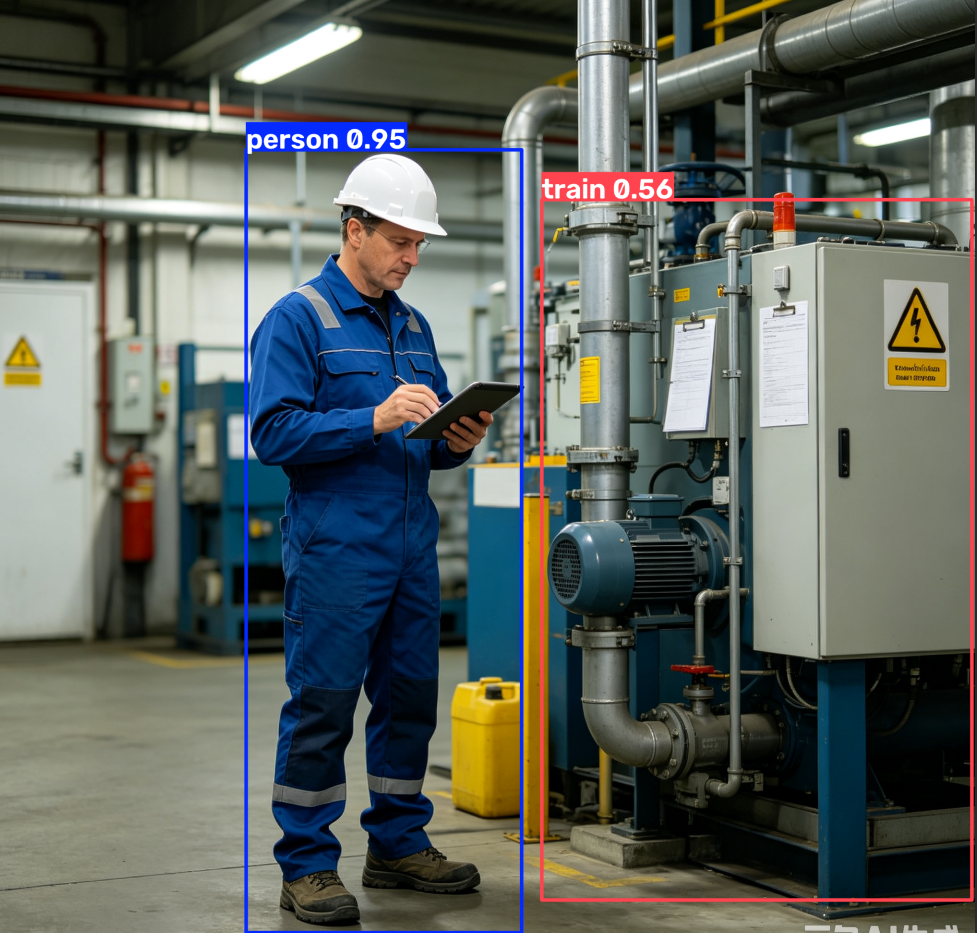

YOLO26默认识别的80个目标里面是没有“安全帽”的。

我们来训练一个能够识别“安全帽”的YOLO26模型。当然这个是模型**微调（Fine-tuning）**，利用官方在COCO（80类）上预训练的权重作为起点，训练出自己的模型，微调的优势在于收敛更快、所需数据更少，因为模型已经学会了通用的视觉特征（如边缘、纹理）。这能极大地降低我们的训练成本和时间。

## 安装和使用数据标注工具

### 安装label-studio

Label Studio安装命令：

`pip install label-studio -i https://pypi.tuna.tsinghua.edu.cn/simple  --trusted-host pypi.tuna.tsinghua.edu.cn`

>旧MacOS编译安装时会卡死在opencv-python-headless，可以安装旧版本 1.21.0
>
>pip install "label-studio==1.21.0" -i https://pypi.tuna.tsinghua.edu.cn/simple --trusted-host pypi.tuna.tsinghua.edu.cn

Label Studio启动命令：

`label-studio start`

也可以用docker安装：

```yaml
services:
  label-studio:
    container_name: label-studio
    image: heartexlabs/label-studio:latest
    volumes:
      - ./volumes/data:/label-studio/data
    ports:
      - "8080:8080"
    user: "1001:1001"
    networks: 
      - label-studio

networks:
  label-studio:
    driver: bridge
    name: label-studio

```

启动后，进入http://localhost:8080/

进入首页：

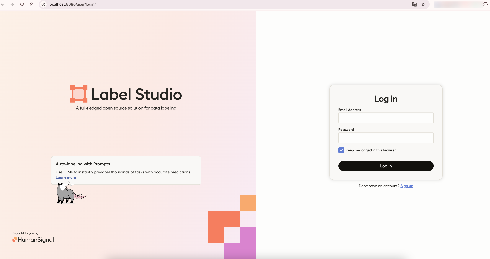

先点击注册一个账号，然后再登录进去。

`test@test.com 12345678`

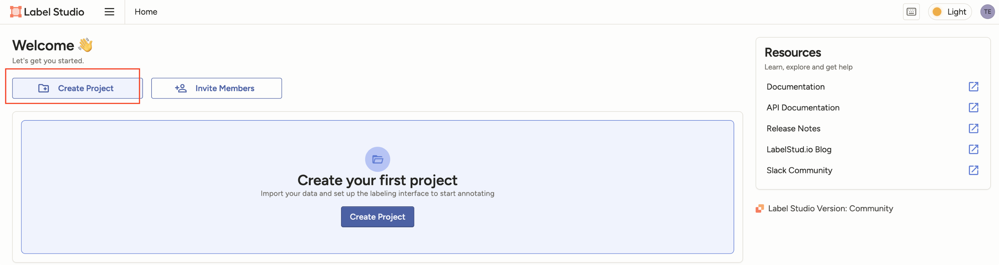

### 新建识别项目

第一步，项目名称设置

第二步：导入数据图片

第三步：标签设置，选基于边界的目标检测

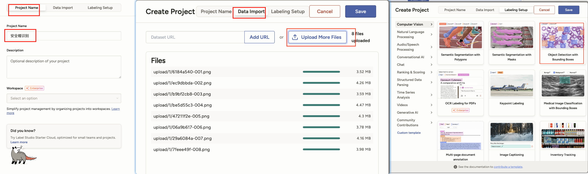

默认的标签删除掉；

接着输入 helmet，点击Add按钮，添加一个标签。

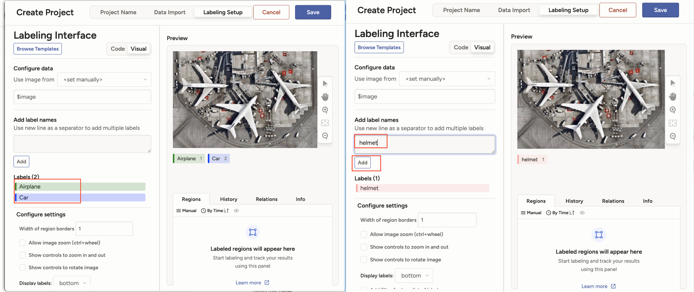

### 图片标注

接下来就是给图片标注了。全选后，点 Lavel 8 Tasks

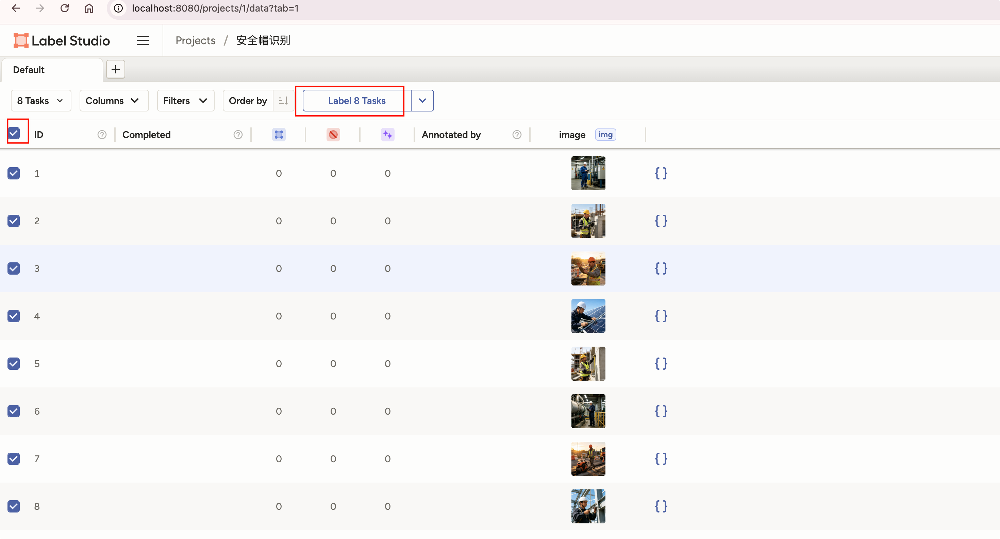

先键盘按1,（选安全帽标签），然后图上 鼠标选中安全帽位置

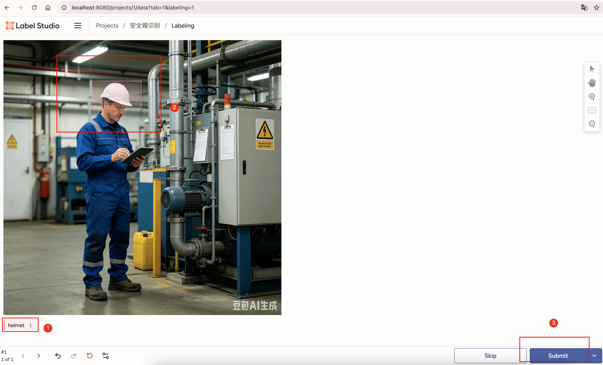

再点 submit提交按钮即可。其他7个图片一样的操作。

### 导出标注文件

全部标注完毕后，我们就可以导出标注文件，进入项目，点 Export 导出

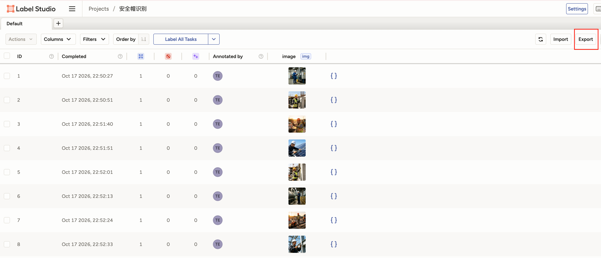

我们选 yolo 格式，然后点Export导出按钮即可。

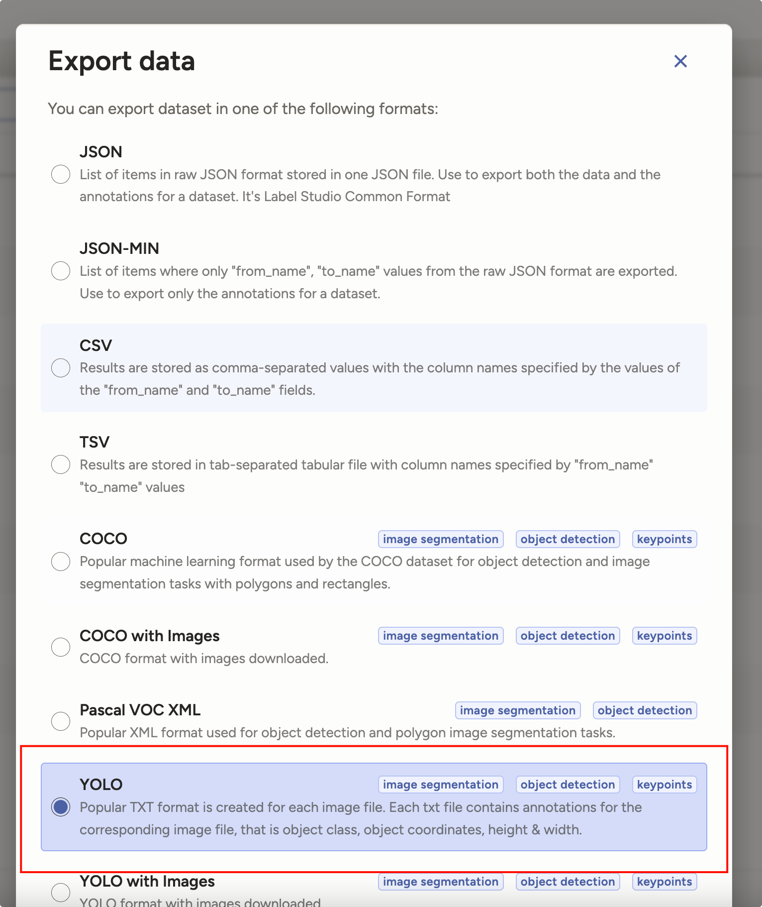

得到标注压缩项目文件，解压下

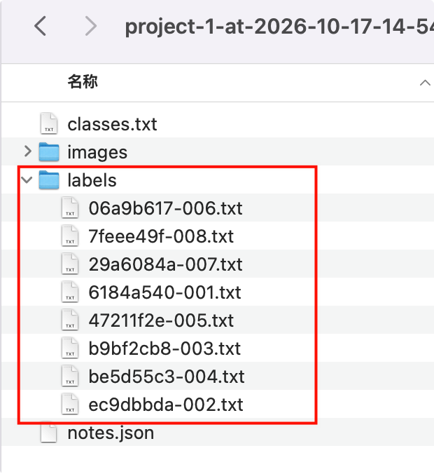{width=400}

labels下就是我们需要的标注文件。

为了和图片名称一一对应，我们要重命名下标注文件。

## 导入项目中

按照标准格式，把图片和标签放到置顶目录。四张训练图片和四张验证图片。

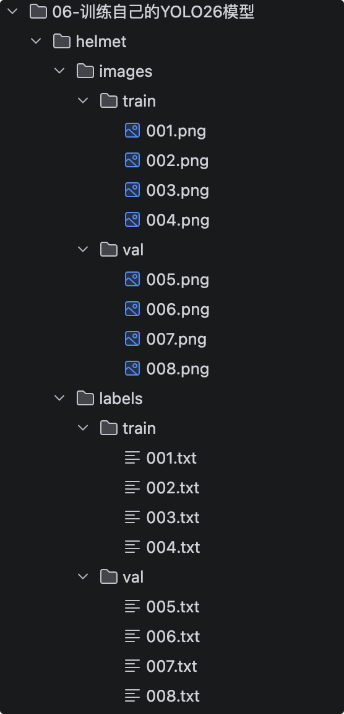{width=400}

## 开始训练

新建 helmet.yaml helmet_train.py 运行来得到权重文件

::: code-group

```yaml [helmet.yaml]
# Ultralytics 🚀 AGPL-3.0 License - https://ultralytics.com/license

# COCO8 dataset (first 8 images from COCO train2017) by Ultralytics
# Documentation: https://docs.ultralytics.com/datasets/detect/coco8
# Example usage: yolo train data=coco8.yaml
# parent
# ├── ultralytics
# └── datasets
#     └── coco8 ← downloads here (1 MB)

# Train/val/test sets as 1) dir: path/to/imgs, 2) file: path/to/imgs.txt, or 3) list: [path/to/imgs1, path/to/imgs2, ..]
path: helmet # dataset root dir
train: images/train # train images (relative to 'path') 4 images
val: images/val # val images (relative to 'path') 4 images
test: # test images (optional)

# Classes
names:
  0: helmet
```

```python [helmet_train.py]
from ultralytics import YOLO

model = YOLO("yolo26n.pt") # 加载预训练权重
results = model.train(data="helmet.yaml", epochs=100, imgsz=640) 
```

:::

运行训练后，得到权重文件

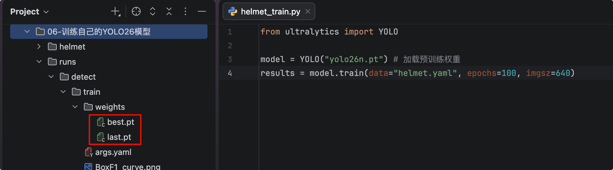

## 用新权重文件识别目标

用得到的权重文件再次去识别安全帽，新建helmet_predict.py

```python
# -*- coding: utf-8 -*-
"""
使用自己训练的安全帽检测模型进行图片推理。
训练图分辨率很高，默认 imgsz=640 时安全帽过小，容易漏检，因此推理时加大输入尺寸。
"""

from pathlib import Path
import sys

from ultralytics import YOLO

sys.path.append(str(Path(__file__).resolve().parents[1]))
from utils.common import print_detections, ensure_dir

# 脚本所在目录，避免工作目录不对时找不到权重和图片
HERE = Path(__file__).resolve().parent
WEIGHTS = HERE / "best.pt"
IMAGE = HERE / "helmet.png"


def main() -> None:
    """加载自定义权重并对单张图片推理、打印并保存结果。"""
    if not WEIGHTS.exists():
        raise FileNotFoundError(f"未找到模型权重： {WEIGHTS}")
    if not IMAGE.exists():
        raise FileNotFoundError(f"未找到待推理图片： {IMAGE}")

    model = YOLO(str(WEIGHTS)) # 加载自己训练的安全帽模型
    out_dir = ensure_dir(HERE / "runs") # 推理结果保存的目录

    results = model.predict(
        source=str(IMAGE),
        conf=0.25,  # 置信度阈值，低于该值的框会被丢掉
        imgsz=960,  # 比训练默认 640 更大，适配高分辨率原图
        save=True,  # 保存带检测框的图片
        project=str(out_dir),
        name="helmet_predict",
        exist_ok=True,
    )

    print(f"类别: {model.names}")
    print_detections(results[0], model.names)
    print(f"结果已保存到: {out_dir / 'helmet_predict'}")

    results[0].show()  # 弹窗显示检测结果


if __name__ == "__main__":
    main()

#======输出======
image 1/1 /01-YOLO26-PRO/06-训练自己的YOLO26模型/helmet.png: 960x960 1 helmet, 540.3ms
Speed: 28.0ms preprocess, 540.3ms inference, 15.4ms postprocess per image at shape (1, 3, 960, 960)
Results saved to /01-YOLO26-PRO/06-训练自己的YOLO26模型/runs/helmet_predict
类别: {0: 'helmet'}
  [0] helmet           conf=0.784 xyxy=[681.0, 322.4, 980.4, 518.4]
结果已保存到: /01-YOLO26-PRO/06-训练自己的YOLO26模型/runs/helmet_predict
```

运行结果，能够识别。

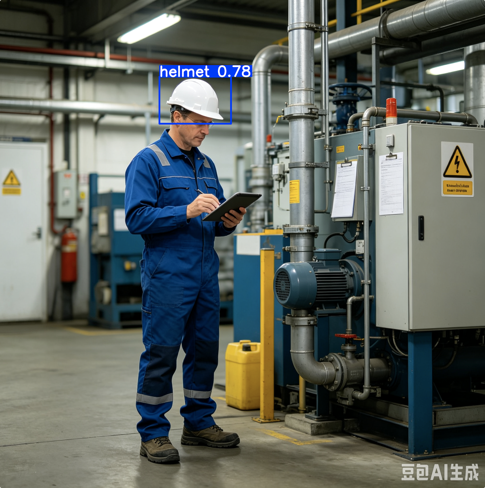

## train方法的核心参数

| 参数         | 作用                                                         | 默认值            | 建议                                                         |
| :----------- | :----------------------------------------------------------- | :---------------- | :----------------------------------------------------------- |
| **data**     | **指定数据集配置文件**（`.yaml`格式）的路径。                | 无                | 这是**必须设置的参数**，没有默认值。                         |
| **epochs**   | **训练轮数**，即整个数据集被模型完整学习的次数。             | `100`             | **小数据集**（如几百张）：`50-100`轮；**大数据集**：`200`轮以上。 |
| **imgsz**    | **输入图像的尺寸**。所有图片会被统一缩放至此大小（宽高相等）后再训练。 | `640`             | **小目标**检测：用`1280`；**追求速度**：用`320`。**数值必须是32的倍数**。 |
| **batch**    | **批次大小**，即每次迭代输入模型进行训练的图片数量。         | `16`              | **在显存允许的范围内尽可能设大**，通常建议不低于`8`。也可设为`-1`让模型自动选择。 |
| **device**   | **指定训练使用的计算设备**。                                 | `None` (自动选择) | 单GPU：`device=0`；多GPU：`device=0,1,2,3`；CPU：`device=cpu`。 |
| **workers**  | **用于数据加载的线程数**，负责将数据从硬盘读入内存并预处理。 | `8`               | **Windows系统需特别注意**，常因多线程问题报错，**建议设为 0**。Linux服务器可适当增大。 |
| **patience** | **早停（Early Stopping）的“耐心值”**。若验证集精度连续这么多轮没有提升，训练将自动停止。 | `50`              | 可有效防止过拟合和节省时间。若想禁用此功能，可设为一个极大值，如`10000`。 |

实例代码：

```python
from ultralytics import YOLO

# 加载预训练模型
model = YOLO('yolov8n.pt')

# 开始训练
results = model.train(
    data='path/to/your/data.yaml',  # 数据集配置文件
    epochs=100,                     # 训练100轮
    imgsz=640,                      # 输入图片尺寸640x640
    batch=16,                       # 每批16张图
    device=0,                       # 使用第一张GPU
    workers=4,                      # 使用4个线程加载数据
    patience=50                     # 50轮无提升则停止
)
```

## train训练后的结果

训练完成后，会生成一些图片文件，是 Ultralytics YOLO 训练完成后自动保存的**标准评估结果**。它们主要分为三类：**置信度阈值曲线**、**混淆矩阵**和**训练过程汇总**。

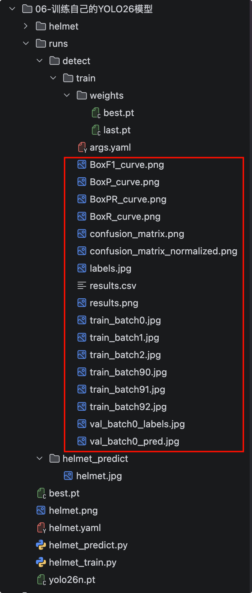{width=400}

### 置信度阈值曲线

**核心性能曲线（用于选“置信度阈值”）**

这四张图都是关于**目标框（Box）** 的指标，横轴是**置信度阈值**（从 0 到 1）。

| 文件名              | 含义                                                         | 实际用途（怎么看）                                           |
| :------------------ | :----------------------------------------------------------- | :----------------------------------------------------------- |
| **BoxP_curve.png**  | **精确率曲线**（Precision）。随着阈值提高，模型变“严格”，精确率通常上升（检测到的更少但更准）。 | 如果**误检**让你很头疼（比如把背景当目标），就参考这张图，选一个高精确率对应的阈值。 |
| **BoxR_curve.png**  | **召回率曲线**（Recall）。随着阈值提高，召回率通常下降（漏检变多）。 | 如果**漏检**让你很头疼（比如没检测出目标），就参考这张图，选一个高召回率对应的阈值。 |
| **BoxF1_curve.png** | **F1 分数曲线**。它是精确率和召回率的**调和平均值**，是综合性能指标。 | **最常用的参考图**。曲线最高点对应的横坐标（如 0.3 或 0.45），就是你推理时设置 `conf` 参数的最佳平衡点。 |
| **BoxPR_curve.png** | **PR 曲线图**（横轴召回率，纵轴精确率）。它不涉及具体阈值，反映模型全局性能。 | 曲线越靠近右上角（面积越大），模型性能越好。训练日志中的 **mAP 值**就是基于这条曲线计算出来的。 |


### 混淆矩阵

**用于看“分错哪里”**

这两张图展示了模型在**验证集**上的分类和定位结果。

| 文件名                              | 含义                                                         | 关键看点                                                     |
| :---------------------------------- | :----------------------------------------------------------- | :----------------------------------------------------------- |
| **confusion_matrix.png**            | **绝对数值混淆矩阵**。行列代表真实标签和预测标签，数字代表具体的检测框数量。 | 对角线（深色）数值越大越好。如果**非对角线**上有亮色格子，说明模型常把 A 类误检为 B 类。 |
| **confusion_matrix_normalized.png** | **归一化混淆矩阵**（百分比）。将每行的总数视为 1，看比例。   | 主要用于排除“样本数量多”带来的视觉误导。如果某行对角线颜色很浅，说明该类别的召回率极低（漏检严重）。 |
| *额外列（Background FN/FP）*        | 最右侧是**漏检**（没框出来），最下侧是**误检**（框错了背景）。 | 如果最右侧数值很高，说明**漏检严重**；如果最下侧很高，说明**误检严重**。 |


### 训练过程汇总

训练过程与数据概览

| 文件名          | 含义                                                         | 怎么用                                                       |
| :-------------- | :----------------------------------------------------------- | :----------------------------------------------------------- |
| **labels.jpg**  | 训练集标注可视化。随机抽取了一批训练图片，展示真实的标注框（GT）分布。 | 快速检查你的数据集标注是否正确，以及目标大小是否合理（框太大或太小会影响训练）。 |
| **results.png** | **最重要的汇总图**。包含了整个训练过程中，随着 `epochs` 增加，损失值（Loss）和精度指标（mAP）的变化曲线。 | **看收敛**：Loss 曲线是否平稳下降？mAP 曲线是否趋于平缓？如果 mAP 最后还在上升，说明可以增加 `epochs`；如果 Loss 震荡剧烈，说明 `batch` 可能太小或学习率不合适。 |
| **results.csv** | 训练过程的**原始数据表格**。记录了每一轮的 Loss、mAP 等具体数值。 | 供数据分析师使用，可以用 Excel 或 Python 读取，绘制更个性化的图表，或对比不同训练跑出来的具体差异。 |

### 实际应用中的“三步走”建议

1. **看 results.png**：确认模型训练是否充分收敛（mAP曲线变平）。
2. **看 BoxF1_curve.png**：找到 F1 最高点对应的置信度 `x`，将这个值设置为你后续 `yolo predict conf=x` 的参数，能达到最佳平衡。
3. **看 confusion_matrix_normalized.png**：
   - 如果最右侧（漏检）颜色深，就适当降低置信度阈值。
   - 如果最下侧（误检）颜色深，就适当提高置信度阈值。
   - 如果某两个类别之间颜色深，说明它们太像了，需要检查数据集标注或考虑合并类别。


