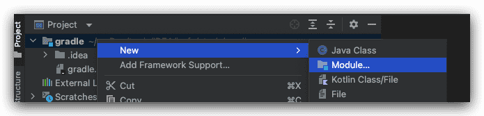
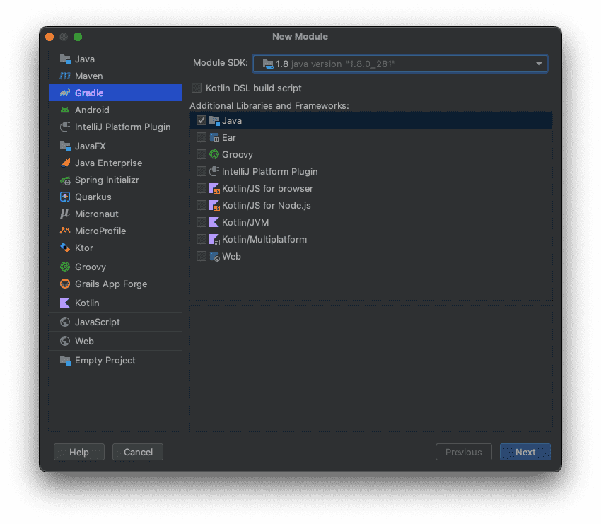
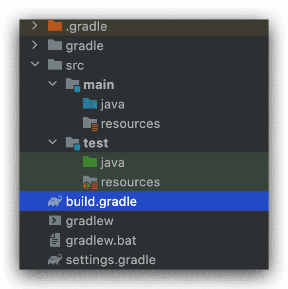

# Gradle与IDEA的集成

**默认情况下Gradle不需要与idea任何配置，可以直接打开idea创建一个Gradle项目即可**

## idea中创建gradle的Java项目

1. 新建Module

   

2. 选择Gradle项目

   
   
   3. 创建完成的项目结构
   
      

## Gradle的项目结构

```js
//gradle -----项目名
  ├── .gradle 			//用来存放当前使用gradle的信息 如版本等相关信息
  ├── .idea 				//存放项目的配置信息，这个文件夹是自动IDEA生成的，包含版本控制信息，历史记录等信息
  └── src
      ├── main
      │   ├── java	//用来存放生产环境中java代码，也就是运行时必须的java代码
      │   └── resources //用来存放生成环境中配置文件
      └── test
          ├── java		//用来存放测试环境中java代码，生产中不需要的代码
          └── resources //用来存放测试环境中配置文件
  ├── build.gradle	//这个文件是整个项目的构建脚本，脚本中内容是以Groovy语言来写的，相当于maven项目中的pom.xml 文件【重点】
  ├── gradle
  │   └── wrapper
  │       ├── gradle-wrapper.jar
  │       └── gradle-wrapper.properties
  ├── gradlew
  ├── gradlew.bat
  ├── settings.gradle //针对module的全局配置，它的作用域所包含的所有module是通过settings.gradle来配置的。

```

## Gradle项目配置文件详解

### build.gradle

`用来对当前gradle项目做局部配置`

```groovy
// 用来声明项目中使用了哪些插件
plugins {
  	//就是将java的一些构建任务tasks引入进来，项目在打包编译的时候，会执行java插件中的任务
    id 'java'
}

//项目的坐标中的一部分：组织名 类似maven中的项目的groupId
group 'com.buubiu'
//项目的坐标中的一部分：版本号 类似于maven中的项目version
version '1.0-SNAPSHOT'

//使用的远程仓库是什么
repositories {
  	//用的maven的远程仓库，他会下载从maven远程仓库下载后，存放到计算机的 .gradle目录中
    mavenCentral()
}

//用来管理项目中的依赖
dependencies {
    //testImplementation 仅仅在测试时可用,打包不会用，类似于maven中 scope的test
    testImplementation 'org.junit.jupiter:junit-jupiter-api:5.7.2'
    testRuntimeOnly 'org.junit.jupiter:junit-jupiter-engine:5.7.2'
  
  	//implementation group 表示 编译、运行、打包可用，类似于maven中scope的complie
    implementation group: 'mysql', name: 'mysql-connector-java', version: '8.0.27'
  	//compileOnly group 仅仅在当前环境可用（IDEA）,在服务器中不用，因为tomcat已经包含了jar包，防止冲突，类似于maven中scope的provided
    compileOnly group: 'javax.servlet', name: 'servlet-api', version: '2.5'
}

test {
    useJUnitPlatform()
}
```

### setting.gradle

`用来对当前的gradle项目进行全局配置`

```groovy
//用来指定项目名称
rootProject.name = 'gradle_01'
```

