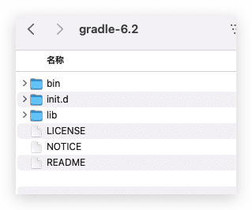
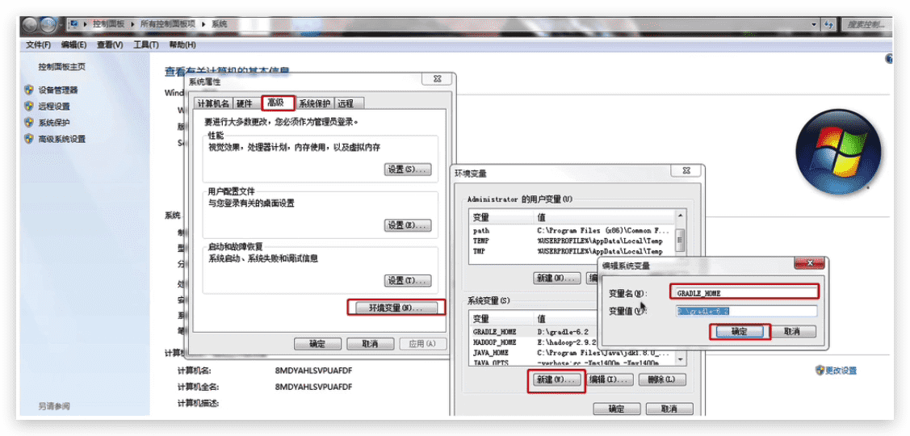
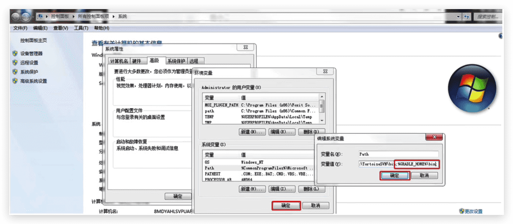
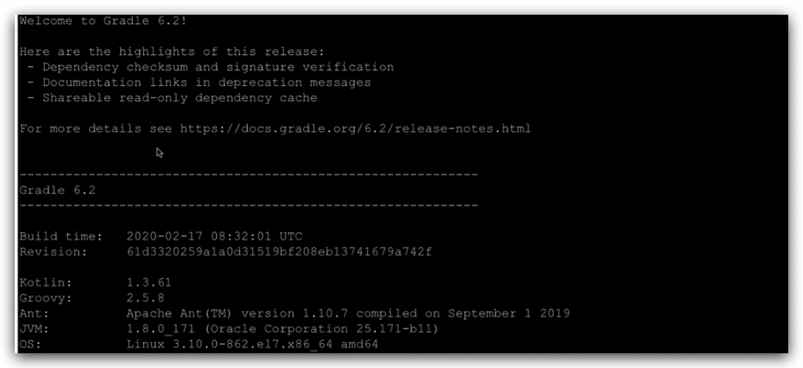

# Gradle的介绍与安装

## 引言

​		项目构建：所谓`构建`，就是对项目进行 编辑 编译 测试 打包 部署 等一系列流程 称之为项目构建。

​		行业主流的项目构建工具：`apache ant`(200年)········`apache maven`(2004年)········`Gradle`(2012年)


## 什么是Gradle

​		`Gradle`是一个基于`Apache Ant`和`Apache Maven`概念的项目自动化构建开源工具。它使用一种基于Groovy语言进行编写的，主要面向Java应用为主，目前也增加了基于Kotlin语言以及Scala语言的支持，目的是为了抛弃基于XML的各种繁琐配置。

## 为什么是Gradle

- 简化了Maven中繁琐的XML配置
- 强大的支持多工程的构建
- 基于groovy脚本构建，其build脚本使用[groovy](https://groovy-lang.org/)语言编写

## Gradle的安装

### 环境准备		

安装前准备环境：

- `windows7+、macOS Sierra+、Linux...`

- `JDK8+`

### 下载Gradle

官方网站：https://gradle.org

### Gradle安装包目录结构



- `bin`：用来存放Gradle的相关脚本文件
- `init.d`：用户日后可以自定义脚本的目录
- `lib`：依赖的jar包

### 配置环境变量

#### Mac

1. 下载到指定目录并解压做

   ```sh
   $ pwd
   /Users/buubiu/gradle/gradle-6.2
   ```

2. 配置环境变量

   ```sh
   # 在最后追加
   $ vim ~/.bash_profile
   export GRADLE_HOME=/Users/buubiu/gradle/gradle-6.2
   export PATH=$PATH:$GRADLE_HOME/bin
   # 生效配置
   $ source ~/.bash_profile
   ```

3. 查看配置是否成功

   ```sh
   $ gradle -version
   Welcome to Gradle 6.2!
   
   Here are the highlights of this release:
    - Dependency checksum and signature verification
    - Documentation links in deprecation messages
    - Shareable read-only dependency cache
   
   For more details see https://docs.gradle.org/6.2/release-notes.html
   
   
   ------------------------------------------------------------
   Gradle 6.2
   ------------------------------------------------------------
   
   Build time:   2020-02-17 08:32:01 UTC
   Revision:     61d3320259a1a0d31519bf208eb13741679a742f
   
   Kotlin:       1.3.61
   Groovy:       2.5.8
   Ant:          Apache Ant(TM) version 1.10.7 compiled on September 1 2019
   JVM:          1.8.0_281 (Oracle Corporation 25.281-b09)
   OS:           Mac OS X 10.16 x86_64
   ```

#### windows

1. 下载到指定位置解压缩

   

2. 配置环境变量

   		

3. 打开`cmd`测试环境变量配置是否成功

   ```sh
   $ gradle -version
   ```

   

#### linux

1. 下载到指定目录并解压缩

   

2. 配置环境变量 `vim /etc/profile`配置文件

   

3. 查看配置是否成功

   
