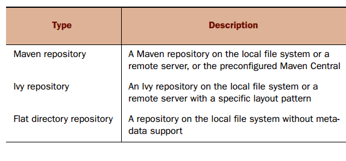
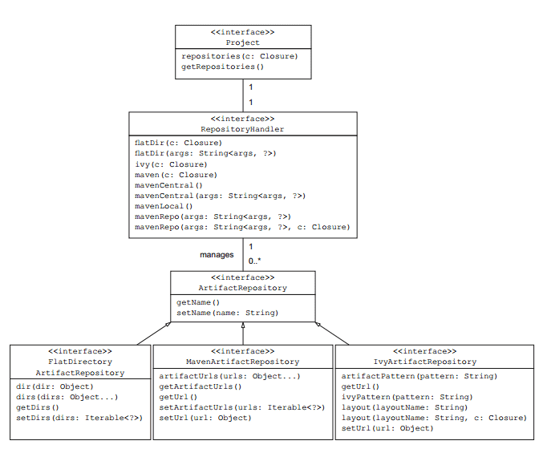
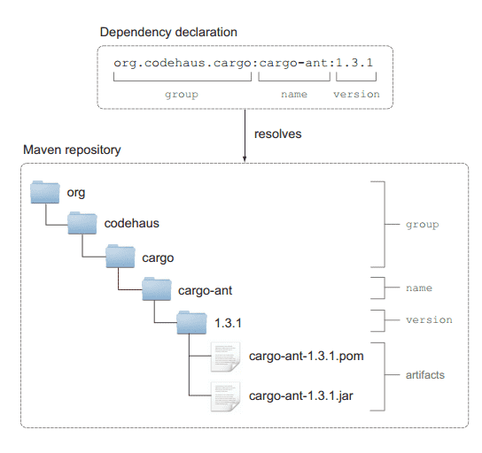

# Groovy仓库配置

## 仓库介绍

 Gradle支持下面三种不同类型的仓库：



下图是配置不同仓库对应的Gradle API：



下面以Maven仓库来介绍，Maven仓库是Java项目中使用最为广泛的一个仓库，库文件一般是以JAR文件的形式存在，用XML(POM文件)来描述库的元数据和它的传递依赖。所有的库文件都存储在仓库的指定位置，当你在构建脚本中声明了依赖时，这些属性用来找到库文件在仓库中的准确位置。group属性标识了Maven仓库中的一个子目录，下图展示了Cargo依赖属性是怎么对应到仓库中的文件的：



RepositoryHandler接口提供了两个方法来定义Maven仓库，mavenCentral方法添加一个指向仓库列表的引用，mavenLocal方法引用你文件系统中的本地Maven仓库。

## 添加Maven仓库

要使用远程的官方Maven仓库你只需要调用mavenCentral方法，如下所示：

```groovy
repositories {
    mavenCentral()
}
```

## 添加本地仓库

本地仓库默认在 `/.m2/repository`目录下，只需要添加如下脚本来引用它：

**如果配置了环境变量`M2_HOME`，则会从指定的maven配置 setting.xml中寻找本地仓库**

```
repositories {
    mavenLocal()
}
```

## 添加自定义Maven仓库

如果指定的依赖不存在与Maven仓库或者你想通过建立自己的企业仓库来确保可靠性，你可以使用自定义的仓库。仓库管理器允许你使用Maven布局来配置一个仓库，这意味着你要遵守artifact的存储模式。你也可以添加验证凭证来提供访问权限，Gradle的API提供两种方法配置自定义的仓库：`maven()`和`mavenRepo()`。下面这段代码添加了一个自定义的仓库，如果Maven仓库中不存在相应的库会从自定义仓库中查找：

```groovy
repositories {
        mavenLocal()
        maven {
            url '/Users/xxxx/maven/repository_3_6_3'
        }
        maven {
            name 'aliyun-maven2'
            url 'https://maven.aliyun.com/repository/central'
        }
        maven {
            name 'aliyun-spring'
            url 'https://maven.aliyun.com/repository/spring'
        }
        maven {
            name 'maven2'
            url 'https://repo1.maven.org/maven2/'
        }
        maven {
            name 'spring'
            url 'https://repo.spring.io/libs-milestone'
        }
        mavenCentral()
    }
```

上面配置顺序表示拉取仓库的顺序
