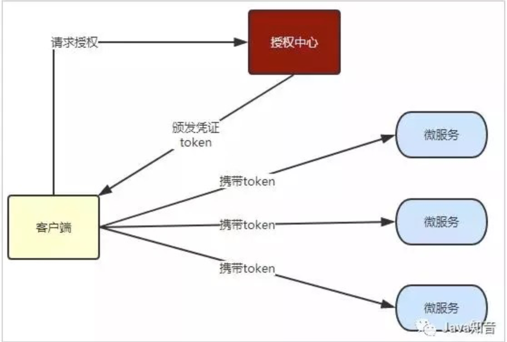
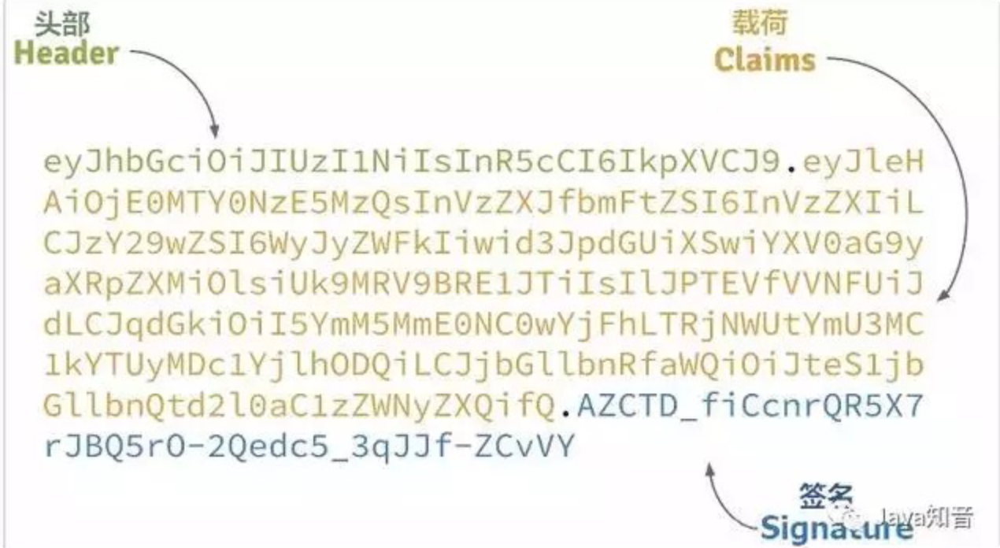
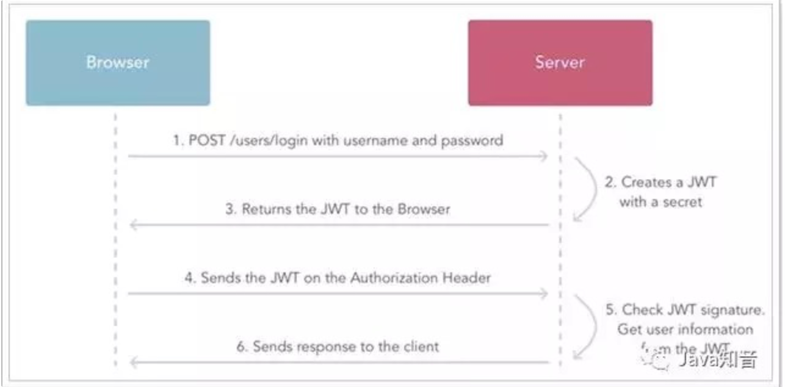
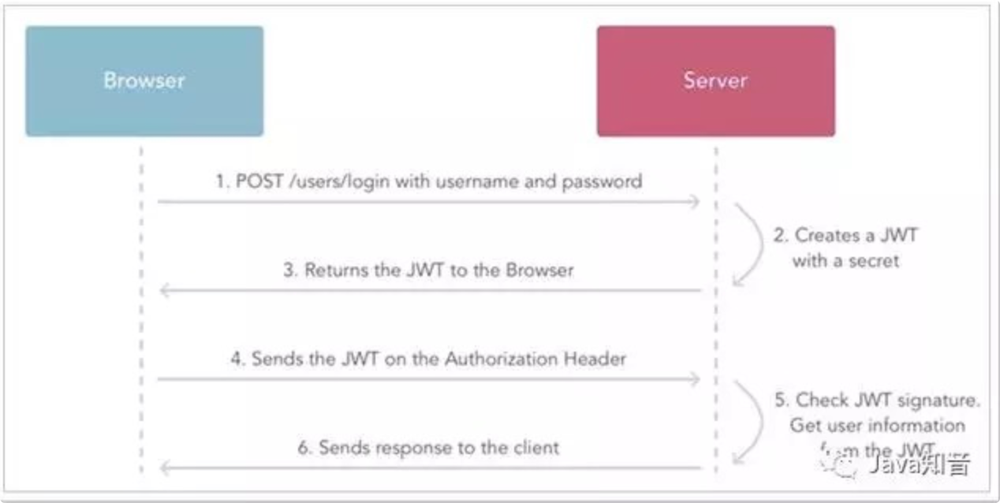
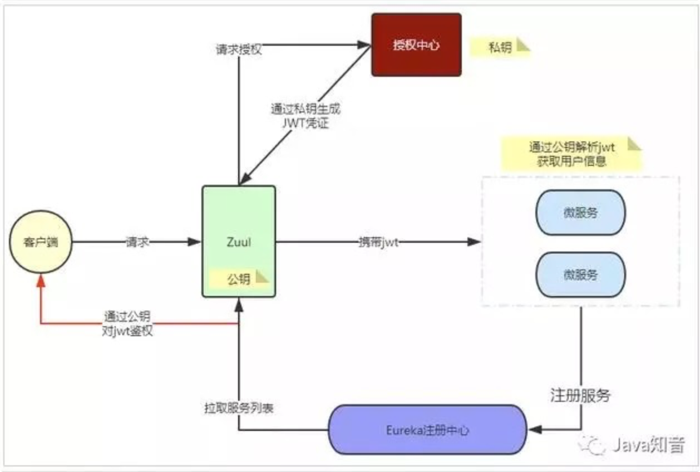

# 微服务统一登录认证JWT

> 摘要：  
> 用户登录后，我们把登录者的信息保存在服务端 session 中，并且给用户一个 cookie 值，记录对应的 session。微服务集群中的每个服务，对外提供的都是 Rest 风格的接口。加密过程中不需要使用密钥，输入明文后由系统直接经过加密算法处理成密文，这种加密后的数据是无法被解密的，无法根据密文推算出明文。secret 是签名的关键，因此一定要保密，我们放到鉴权中心保存，其它任何服务中都不能获取 secret。

## 无状态登录原理

### 什么是有状态？

有状态服务，即服务端需要记录每次会话的客户端信息，从而识别客户端身份，根据用户身份进行请求的处理，典型的设计如 tomcat 中的 session。例如登录：用户登录后，我们把登录者的信息保存在服务端 session 中，并且给用户一个 cookie 值，记录对应的 session。然后下次请求，用户携带 cookie 值来，我们就能识别到对应 session，从而找到用户的信息。

缺点是什么？

- 服务端保存大量数据，增加服务端压力

- 服务端保存用户状态，无法进行水平扩展

- 客户端请求依赖服务端，多次请求必须访问同一台服务器

### 什么是无状态

微服务集群中的每个服务，对外提供的都是 Rest 风格的接口。而 Rest 风格的一个最重要的规范就是：服务的无状态性，即：

- 服务端不保存任何客户端请求者信息

- 客户端的每次请求必须具备自描述信息，通过这些信息识别客户端身份

**带来的好处是什么呢？**

- 客户端请求不依赖服务端的信息，任何多次请求不需要必须访问到同一台服务

- 服务端的集群和状态对客户端透明

- 服务端可以任意的迁移和伸缩

- 减小服务端存储压力

### 如何实现无状态

**无状态登录的流程：**

1.  当客户端第一次请求服务时，服务端对用户进行信息认证（登录）

2.  认证通过，将用户信息进行加密形成 token，返回给客户端，作为登录凭证

3.  以后每次请求，客户端都携带认证的 token

4.  服务端对 token 进行解密，判断是否有效。

流程图：

整个登录过程中，最关键的点是什么？

**token 的安全性**

token 是识别客户端身份的唯一标示，如果加密不够严密，被人伪造那就完蛋了。采用何种方式加密才是安全可靠的呢？我们将采用 JWT + RSA 非对称加密

### JWT

#### 简介

JWT，全称是 Json Web Token， 是 JSON 风格轻量级的授权和身份认证规范，可实现无状态、分布式的 Web 应用授权；  
官网：https://jwt.io  
GitHub 上 jwt 的 java 客户端：https://github.com/jwtk/jjwt

#### 数据格式

JWT 包含三部分数据：

**Header：头部，通常头部有两部分信息：**

- 声明类型，这里是 JWT

- 加密算法，自定义

我们会对头部进行 base64 加密（可解密），得到第一部分数据

**Payload：载荷，就是有效数据，一般包含下面信息：**

- 用户身份信息（注意，这里因为采用 base64 加密，可解密，因此不要存放敏感信息）

- 注册声明：如 token 的签发时间，过期时间，签发人等

这部分也会采用 base64 加密，得到第二部分数据

**Signature：签名，是整个数据的认证信息。一般根据前两步的数据，再加上服务的密钥（secret）（不要泄漏，最好周期性更换），通过加密算法生成。用于验证整个数据完整和可靠性**

生成的数据格式：

可以看到分为 3 段，每段就是上面的一部分数据

#### JWT 交互流程

流程图：

步骤翻译：

1.  用户登录

2.  服务的认证，通过后根据 secret 生成 token

3.  将生成的 token 返回给浏览器

4.  用户每次请求携带 token

5.  服务端利用公钥解读 jwt 签名，判断签名有效后，从 Payload 中获取用户信息

6.  处理请求，返回响应结果

因为 JWT 签发的 token 中已经包含了用户的身份信息，并且每次请求都会携带，这样服务的就无需保存用户信息，甚至无需去数据库查询，完全符合了 Rest 的无状态规范。扩展：彻底理解 cookie，session，token

#### 非对称加密

加密技术是对信息进行编码和解码的技术，编码是把原来可读信息（又称明文）译成代码形式（又称密文），其逆过程就是解码（解密），加密技术的要点是加密算法，加密算法可以分为三类：对称加密，如 AES

- **基本原理：** 将明文分成 N 个组，然后使用密钥对各个组进行加密，形成各自的密文，最后把所有的分组密文进行合并，形成最终的密文。

- **优势：** 算法公开、计算量小、加密速度快、加密效率高

- **缺陷：** 双方都使用同样密钥，安全性得不到保证

**非对称加密，如 RSA**

- **基本原理：** 同时生成两把密钥：私钥和公钥，私钥隐秘保存，公钥可以下发给信任客户端

- **私钥加密，** 持有私钥或公钥才可以解密

- **公钥加密，** 持有私钥才可解密

- **优点：** 安全，难以破解

- **缺点：** 算法比较耗时

**不可逆加密，如 MD5，SHA**

- **基本原理：** 加密过程中不需要使用密钥，输入明文后由系统直接经过加密算法处理成密文，这种加密后的数据是无法被解密的，无法根据密文推算出明文。

**RSA 算法历史：**  
1977 年，三位数学家 Rivest、Shamir 和 Adleman 设计了一种算法，可以实现非对称加密。这种算法用他们三个人的名字缩写：RSA

**结合 Zuul 的鉴权流程**

我们逐步演进系统架构设计。需要注意的是：secret 是签名的关键，因此一定要保密，我们放到鉴权中心保存，其它任何服务中都不能获取 secret。

#### 没有 RSA 加密时

在微服务架构中，我们可以把服务的鉴权操作放到网关中，将未通过鉴权的请求直接拦截，如图：

1.  用户请求登录

2.  Zuul 将请求转发到授权中心，请求授权

3.  授权中心校验完成，颁发 JWT 凭证

4.  客户端请求其它功能，携带 JWT

5.  Zuul 将 jwt 交给授权中心校验，通过后放行

6.  用户请求到达微服务

7.  微服务将 jwt 交给鉴权中心，鉴权同时解析用户信息

8.  鉴权中心返回用户数据给微服务

9.  微服务处理请求，返回响应

发现什么问题了？

每次鉴权都需要访问鉴权中心，系统间的网络请求频率过高，效率略差，鉴权中心的压力较大。

**结合 RSA 的鉴权**

直接看图：

- 我们首先利用 RSA 生成公钥和私钥。私钥保存在授权中心，公钥保存在 Zuul 和各个微服务

- 用户请求登录

- 授权中心校验，通过后用私钥对 JWT 进行签名加密

- 返回 jwt 给用户

- 用户携带 JWT 访问

- Zuul 直接通过公钥解密 JWT，进行验证，验证通过则放行

- 请求到达微服务，微服务直接用公钥解析 JWT，获取用户信息，无需访问授权中心

> 来源：[微服务统一登录认证怎么做？JWT？](https://mp.weixin.qq.com/s?__biz=MzIxODQxMjc0MA==&mid=2247500683&idx=1&sn=1ad63c970e08ae99978c82d628008e9d&chksm=97e86020a09fe936d86811c26d33314779e5177eb2e4f367f6203db96325a7f6bb8bef7e7fe7&mpshare=1&scene=1&srcid=&sharer_sharetime=1582114106398&sharer_shareid=f338cc331a976ce0a70f3d7d541f6afe%23rd)
